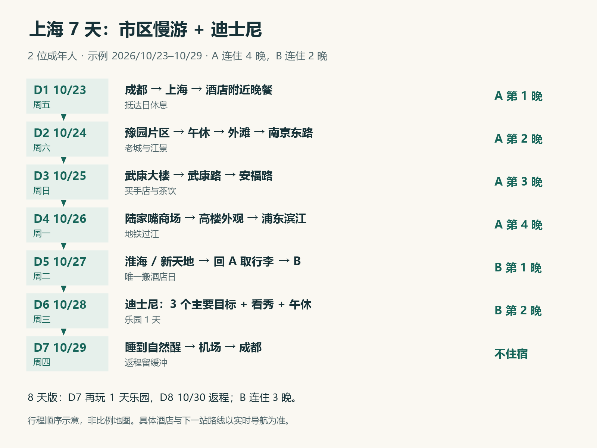
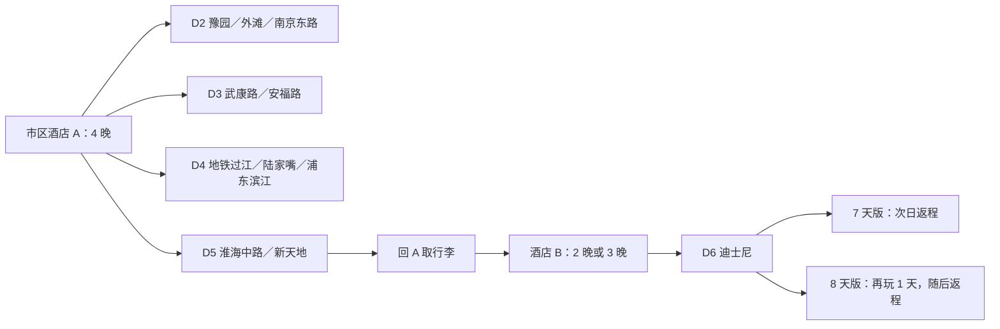
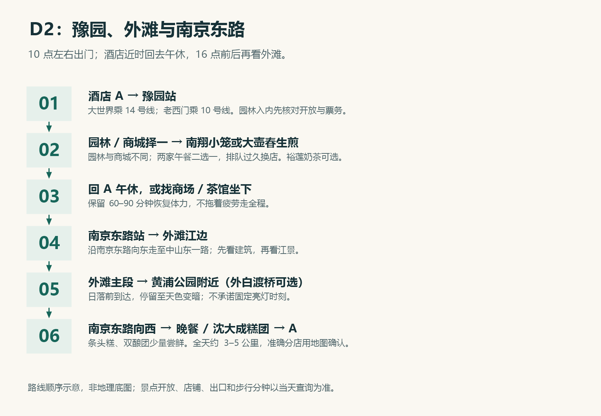
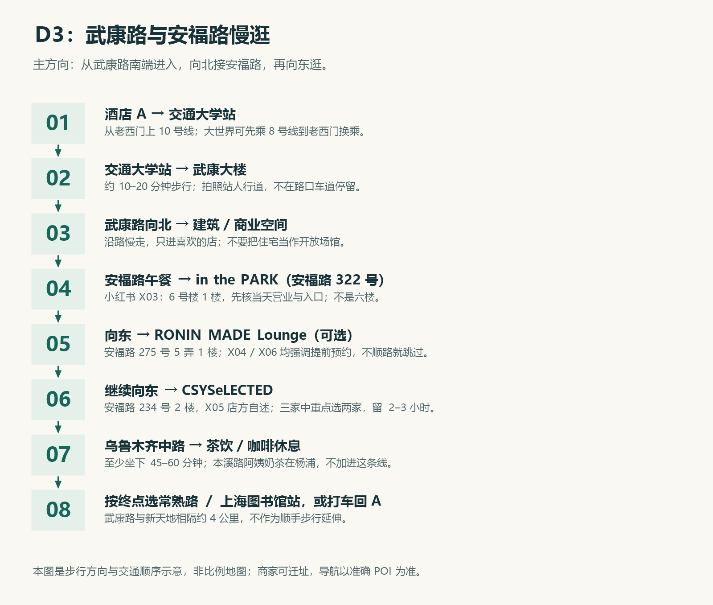
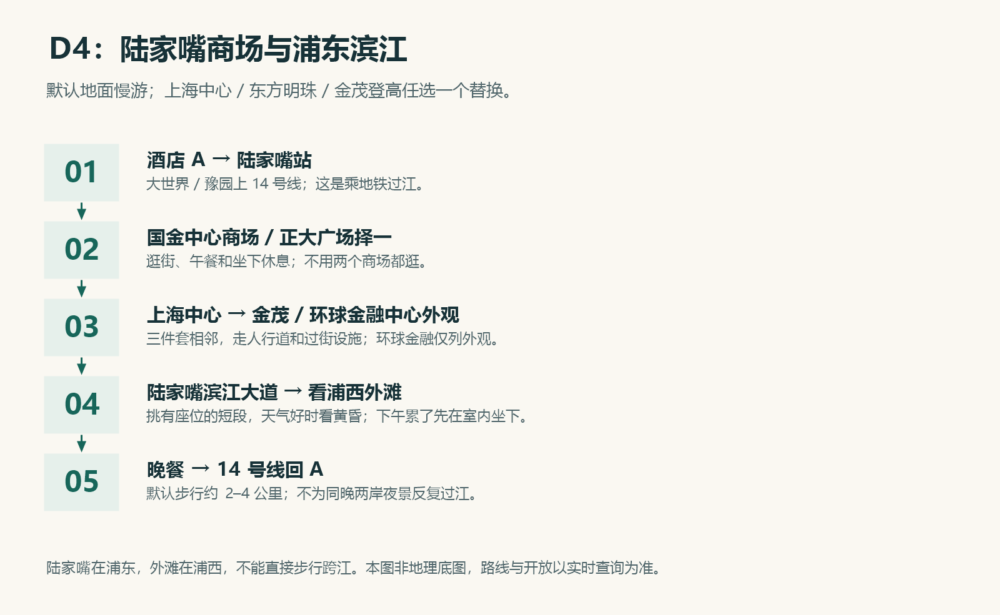
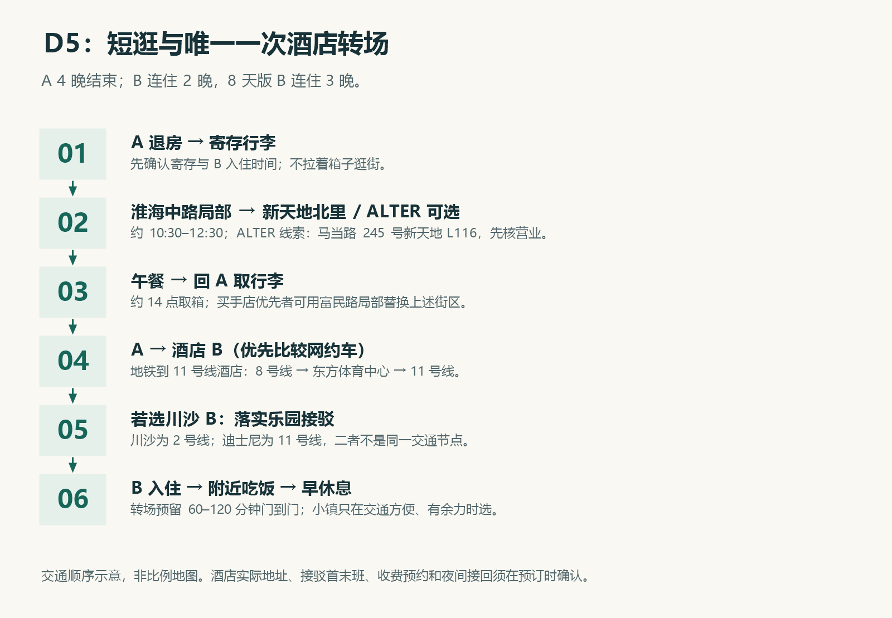
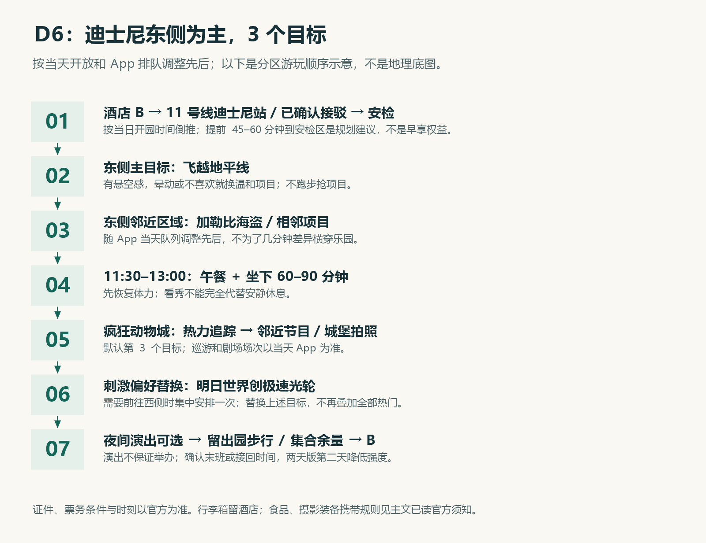

# 上海 10 月下旬轻松旅行攻略

**成都出发 · 2 位成年人 · 5–8 天 · 酒店 200–500 元／间／晚**  
**主方案：7 天 6 晚，迪士尼 1 天；8 天 7 晚适合迪士尼 2 天，第二天降低强度。**  
编制与资料审读日期：2026-10-13。示例出发日：2026-10-23，实际日期可整体平移。

**本版资料：113 篇旅行指南＋10 篇小红书笔记文字补充审读。** 小红书主要用于补充实际吃住经验、买手店地址、预约要求和饮品线索；包含店方宣传、AI整理与短体验，单独记录，不把它们全部算作独立实游攻略。

你们的重点是外滩、陆家嘴、知名街区、买手店、特色美食和奶茶。本攻略按街区集中游玩：每天一个主要区域，通常 10 点左右出门，保留坐下来吃饭、喝茶和回酒店休息的时间。市区酒店连续住 4 晚，迪士尼周边连续住 2–3 晚，全程只换一次酒店。

## 目录

- [先看行程与路线总览](#一先看行程与路线总览)
- [住哪里最方便](#二住哪里最方便)
- [7 天每日详细路线](#三7-天每日详细路线)
- [迪士尼 1 天与 2 天玩法](#四迪士尼1-天与-2-天玩法)
- [特色美食、奶茶、买手店](#五吃什么喝什么买什么)
- [5、6、8 天调整方案](#六按假期长度调整)
- [交通与导航入口](#七交通和导航速查)
- [两人预算](#八两人预算)
- [下雨、疲劳与行前准备](#九下雨疲劳与行前准备)
- [资料依据和使用边界](#十资料依据和使用边界)

## 一、先看行程与路线总览

### 推荐：7 天 6 晚

| 天数／示例日期 | 当天重点 | 建议节奏 | 当晚住宿 |
|---|---|---|---|
| D1 · 10/23 周五 | 成都 → 上海，入住、附近吃饭 | 抵达日不排远处景点 | 市区 A，第 1 晚 |
| D2 · 10/24 周六 | 豫园片区 → 外滩黄昏 → 南京东路夜逛 | 园林可选；午后回酒店休息 | A，第 2 晚 |
| D3 · 10/25 周日 | 武康大楼 → 武康路 → 安福路 → 乌鲁木齐中路 | 买手店、街拍、奶茶，走累就坐 | A，第 3 晚 |
| D4 · 10/26 周一 | 陆家嘴商场 → 三件套外观 → 浦东滨江 | 登高任选一个，默认地面慢游 | A，第 4 晚 |
| D5 · 10/27 周二 | 淮海中路 → 新天地 → 取行李 → 酒店 B | 唯一搬酒店日，下午转场 | 迪士尼周边 B，第 1 晚 |
| D6 · 10/28 周三 | 上海迪士尼乐园 | 3 个主要项目＋看秀，中午休息 | B，第 2 晚 |
| D7 · 10/29 周四 | 睡到自然醒，上海 → 成都 | 优先下午或傍晚航班 | 无 |

**住宿日期：A 入住 10/23、退房 10/27；B 入住 10/27、退房 10/29。** 若玩两天乐园，B 改为 10/30 退房，D7 继续入园、D8 返程。

图中箭头表示行程顺序与交通方式，**不是按比例的城市地图**。实际步行路线以地图 App 为准。

**为什么不增加苏州、杭州或多个古镇？** 你们已有城市地标、街区购物和 1–2 天乐园需求。增加外地城市会占用休息与购物时间，还可能多搬一次行李。朱家角、七宝、M50 等仅作为替换项。

## 二、住哪里最方便

### 市区 A：首选大世界／老西门，其次豫园／陆家浜路

| 区域 | 交通优势 | 适合你们的原因 | 订房检索关键词 |
|---|---|---|---|
| **大世界站附近** | 8、14 号线 | 去豫园、陆家嘴和淮海路方便，周边吃饭选择多 | 上海 大世界 地铁站 酒店 |
| **老西门站附近** | 8、10 号线 | 10 号线到武康路入口交通大学站；接虹桥交通方便 | 上海 老西门 地铁站 酒店 |
| 豫园站附近 | 10、14 号线 | 老城、外滩方向方便，热门时段房价可能偏高 | 上海 豫园 地铁站 酒店 |
| 陆家浜路站附近 | 8、9 号线 | 可扩大 200–500 元房源筛选范围，去核心景区多一段交通 | 上海 陆家浜路 地铁站 酒店 |

**实用选择：先按 300–450 元筛选大世界／老西门的经济或中档连锁酒店；没有合适房源再扩到陆家浜路。** 汉庭、如家、锦江之星、全季等可作为搜索品牌，但必须看具体分店，品牌名不能代替位置、卫生和隔音判断。这里的价格是预算筛选条件，不是查到的实时房价。

选房顺序：

1. 导航实际步行到地铁口尽量 **600 米以内**，理想是 300–500 米；不要只看平台“距地铁直线距离”。
2. 明确是 **两人入住的整间客房**，核对大床／双床、独立卫浴、外窗和电梯。
3. 看近 1–3 个月差评中的隔音、卫生、异味与热水问题；尽量避开临高架、酒吧楼上或无窗地下房。
4. 按整段 4 晚总价比较，核对周末加价、早餐、取消截止时间与行李寄存。

**小红书住宿经验怎么用：** [X02 实游记录](https://www.xiaohongshu.com/explore/69eb7365000000003502b572)选择“白玉兰酒店（南京东路外滩店）”，评价交通方便。可将这个名称作为订房搜索候选，与大世界／老西门房源比较；若想晚饭后随时散步去外滩，南京东路更合适，若更重视整体价格和老城往返，大世界／老西门仍优先。笔记未给出你们日期的房价，不能保证该店每晚 200–500 元。订房时核对平台的完整分店名、地图位置、整段价格与近月评价。

### 迪士尼周边 B：近 11 号线优先，可靠接驳作备选

| 方案 | 优点 | 要确认什么 | 推荐程度 |
|---|---|---|---|
| **康新公路／秀沿路站附近，11 号线** | 去迪士尼直达，不依赖酒店班车；散场交通比较自主 | 从酒店到地铁口的真实步行路；出站后到乐园安检仍要步行 | **想省心、自己掌握时间，优先** |
| **川沙正规酒店，提供可靠接驳** | 吃饭方便，选择可能更丰富；接驳合适时省换乘 | 接驳是否收费、是否预约、最早去程、演出结束后的回程、集合点和误车处理 | 只有接驳落实后才选 |

**川沙站属于 2 号线，迪士尼站属于 11 号线。住川沙并不等于坐一站地铁到迪士尼。** 没有接驳时往返通常需要打车或多次换乘。也不要把酒店名称里的“迪士尼店”理解成位于乐园门口。

预算继续按 **200–500 元／间／晚** 筛选；优先正规酒店而非位置偏、接驳不清楚的民宿。官方主题酒店可另行比较，但不作为这个预算的默认选项。若你们最终只玩 1 天乐园、又非常不愿搬酒店，也可全程住 A，接受 D6 更长的往返通勤。

**新增御桥备选：** X02 实游在乐园前一晚住“如家御桥店”。御桥有 11／18 号线，去迪士尼可走 11 号线；只有准确分店到站步行短、整段总价合适时才选。笔记中的简称并未证明当前营业、接驳或实时房价，先定位完整分店，别把“御桥店”当已推荐预订链接。你们预算内的比较顺序建议为：康新公路／秀沿路地铁房 → 御桥地铁房 → 接驳已落实的川沙酒店。

| 阶段 | 建议筛选价／间／晚 | 优先条件 | 搜索候选 |
|---|---:|---|---|
| A，连续 4 晚 | 300–450 元 | 地铁实走不超过约 600 米、有窗、电梯、安静 | 大世界／老西门连锁；白玉兰 南京东路外滩店作比较 |
| B，连续 2–3 晚 | 250–400 元 | 11 号线近站或明确夜间接驳 | 康新公路／秀沿路；如家 御桥店作比较 |

按这个筛选目标，7 天住宿两人共约 **1,700–2,600 元**，8 天约 **1,950–3,000 元**；这是预算目标，不是已查成交价。超过 500 元时换同一地铁区域的房源，保持连住，避免为了便宜几十元频繁搬家。

给酒店的询问文本，可直接复制：

> 我们两位成年人，计划连续住两／三晚，其中一天／两天去迪士尼。请确认当天接驳的最早去程、夜间演出后回程、预约和收费方式、具体集合点；若错过回程，建议的替代交通和夜间车程是什么？房间是否有外窗、电梯、独立卫浴，能否寄存行李？

## 三、7 天每日详细路线

下列时间是宽松安排窗口，不是景点营业时间。步行距离与车程为规划估算，包含逛店会增加步数；地铁出口、交通临时调整与商户状态出门前用导航复核。

### D1｜成都到上海：入住后只在附近吃饭

**航班建议：** 搜成都天府 TFU／双流 CTU 到上海虹桥 SHA／浦东 PVG 的直飞，按“含行李往返总价＋起降时间＋机场交通”比较。优先中午前后出发、下午到上海的航班。去程虹桥到市区便利；若回程票价合适，浦东离迪士尼周边一般更近。两个机场可以分别购买，但核对航站楼和行李额度。

| 抵达机场 | 去市区 A 的参考路径 | 给交通留出的时间 |
|---|---|---|
| 虹桥 T1／T2 | 10 号线 → 老西门／豫园；住大世界可在老西门换 8 号线 | 出站取行李后，酒店门到门约 60–90 分钟 |
| 浦东 T1／T2 | 2 号线 → 陆家嘴换 14 号线 → 豫园／大世界 | 出站取行李后，酒店门到门约 90–120 分钟 |

酒店不靠近车站、行李较多或航班晚到时，两人直接网约车更轻松；费用以叫车页面为准。以上时间不含航班晚点，落地到吃上晚饭还要加取行李和入住时间。

**晚餐：** 找酒店附近的生煎＋牛肉粉丝汤，或本帮小馆。大世界一带可把云南南路作为找吃饭的区域关键词。当天不要求去外滩，避免为一张夜景照片往返折腾。

### D2｜老城＋外滩＋南京东路：经典上海

**主线：A → 豫园片区 → A 休息 → 外滩黄昏 → 南京东路 → A。**

| 时间窗口 | 安排 | 路线与取舍 |
|---|---|---|
| 10:00–12:00 | 园林或商城选一个为主，九曲桥／湖心亭外观短停 | 大世界乘 14 号线到豫园；老西门乘 10 号线到豫园。入园慢游时商城只短逛；先确认开放和购票入口 |
| 12:00–13:00 | 小笼＋小吃午餐 | 南翔馒头店等仅顺路选择，排队超过约 30 分钟就换店 |
| 13:30–15:30 | 回 A 休息 | 酒店较近，这是安排午休的优势；不想折返可在商场／茶馆坐 45–60 分钟 |
| 16:00–18:00 | 外滩建筑与江景，等天色变暗 | 南京东路站出站，沿南京东路向东至中山东一路；先看建筑，再上江边步道 |
| 18:00–20:00 | 南京东路晚餐、商场和伴手礼 | 从外滩沿南京东路往西走，走到自己想逛的店即可 |

**豫园园林、豫园商城、城隍庙道观是三个不同空间。** 只想拍建筑、吃小吃，可以保留商城和九曲桥，省去收费园林。不要把十月旅游当成春节灯会安排。

外滩轻松步行线：**南京东路／和平饭店外观 → 外滩观景步道 → 黄浦公园附近**。外白渡桥、外滩源可加选；若疲劳，到外滩主段即可。南京东路站至江边约 10–20 分钟，外滩选段约 0.8–1.5 公里。全天按 **3–5 公里**步行预算，周六人多时主动缩短。

十月下旬日落较早，约 **17 点前后**逐渐进入黄昏；当天日落和灯光以实时情况为准，不承诺固定亮灯时间。若想完整看夜景，晚餐放到看完之后；若饿了，可提前在南京东路吃，再回江边，但会多走一段。

**餐饮顺序：** 午餐小笼，晚餐本帮菜，伴手礼选沈大成等糕团或鲜肉月饼。南京东路适合看热闹、买老字号食品；买手店留给 D3，不必这天逛整条南京路。

**落实到店：** 午餐搜索“南翔馒头店 豫园”，优先鲜肉小笼，两人分享一笼再按食量加点；排队过长可换“大壶春 豫园店”的生煎。糕团搜索“沈大成 南京东路”，选条头糕／双酿团少量现买；豫园茶饮可选“裕莲茶楼 豫园”的琥珀奶茶，蛋挞两人共享。南翔和沈大成在 [X02 实游](https://www.xiaohongshu.com/explore/69eb7365000000003502b572)与 [X10 豫园餐饮整理](https://www.xiaohongshu.com/explore/69fed3b00000000037034cd9)中重复出现；裕莲是 X10 单篇候选。具体分店、门牌、菜单与营业仍按地图／店方确认，午餐、奶茶、糕团不要求全部吃完。

位置还有原指南交叉：[豫园指南](https://www.chinahighlights.com/shanghai/attraction/yuyuan-garden.htm)将南翔放在豫园商城区域，[城隍庙豫园指南](https://gotravellingworld.com/shanghai-city-god-temple-travel-guide/)明确写大壶春豫园店，[南京路指南](https://www.travelchinaguide.com/attraction/shanghai/nanjing_road.htm)列沈大成。它们支持区域顺路关系，没有给足准确门牌，本版用分店关键词导航。

### D3｜武康路＋安福路：买手店与奶茶慢逛

**主线：交通大学站 → 武康大楼 → 武康路向北 → 安福路向东 → 乌鲁木齐中路 → 按体力返程。**

1. **10:30–11:15，武康大楼。** 从 A 经老西门上 10 号线至交通大学站，按导航走到武康大楼，约 10–20 分钟。拍照从人行道找角度，路口人流多，不在车道中间停留。
2. **11:15–12:15，武康路向北。** 看梧桐、老洋房和街景，沿路只进感兴趣的店。武康庭等商业空间可以作为停靠点，具体商户看当天地图。
3. **12:15–13:15，午餐。** 选安福路或邻近街区的简餐／小馆，避免为某家网红店多排一小时。
4. **13:15–16:30，安福路与乌鲁木齐中路。** 按“小红书门店停靠线”向东逛，三家中重点选两家，留 2–3 小时；至少安排一次 45–60 分钟茶饮／咖啡休息。
5. **17:00 前后返程或吃晚饭。** 结束在安福路东侧时，比较到常熟路站：回大世界可乘 1 号线至一大会址·黄陂南路换 14 号线；回老西门可乘 1 号线至陕西南路换 10 号线。若结束在武康路中南段，比较上海图书馆站 10 号线；最终看实时导航，疲劳时直接打车回 A。

**小红书门店停靠线：** 安福路西侧 **in the PARK（322 号，6 号楼 1 楼）→ RONIN MADE Lounge（275 号 5 弄 1 楼，仅预约确认后加入）→ CSYSeLECTED（234 号 2 楼）→ 乌鲁木齐中路**。不要把“6 号楼”误读为六楼。地址来源与导航入口见第五章；路边过街、弄堂入口按地图与店方指引。RML 若预约时段会造成折返，就略过，优先服装／配饰买手店和坐下休息。

街区主线含到达及离开步行约 **2.5–4 公里**，逛店后总步数可能更多。**武康路与新天地相隔约 4 公里，不作为顺手步行延伸。** 下午购物时段更适合你们；周日若太拥挤，可把 D3 与 D4 对调，但需要重新核对加选场馆的开放日期。

喜欢服装买手店胜过地标时，D3 主线完成后不再增加静安寺或田子坊；D5 可以把新天地短线替换为长乐路／巨鹿路／富民路一小段。

### D4｜陆家嘴：商场、摩天楼与滨江

**主线：A → 陆家嘴站 → 国金中心商场／正大广场择一 → 上海中心、金茂、环球金融中心外观 → 浦东滨江 → A。**

| 时间窗口 | 默认轻松版 | 加选说明 |
|---|---|---|
| 10:30–12:00 | 14 号线到陆家嘴，逛一个商场 | 大世界／豫园上 14 号线可到陆家嘴；老西门可先乘 10 号线至豫园换 14 |
| 12:00–13:30 | 商场午餐、坐下休息 | 商场餐饮方便，不要求专程找老字号 |
| 13:30–15:00 | 三件套外观、城市街拍 | 上海中心、金茂、环球金融中心相邻，沿人行道与过街设施走 |
| 15:30–18:00 | 陆家嘴滨江大道，看浦西外滩 | 先在室内坐一会，再去江边；挑有座位的短段，不必全线走完 |
| 18:00 后 | 晚餐，地铁回 A | 14 号线返回，避免为了再看浦西夜景额外跨江 |

**默认不用买观景票。** 外观＋滨江已能完成陆家嘴打卡。想登高则从上海中心／东方明珠／金茂中选一个，替换 13:30–15:30 的地面活动，预留约 1.5–2 小时；先看能见度和官方在售票种。环球金融中心仅列外观，不依据旧攻略安排观光层。

国金中心偏高端购物，正大广场可用于普通逛街和用餐；两个都逛容易重复。朵云书院可作为上海中心内的兴趣加选，但先确认当前预约、入口与消费规则，不能当作无需预约的免费观景台。

全天默认 **2–4 公里**步行。**外滩在浦西，陆家嘴在浦东，不能步行直接跨黄浦江。** 地铁是本方案的默认过江方式。公共轮渡与收费观光游船另行选择，见交通章节。

### D5｜淮海中路＋新天地：短逛后搬一次酒店

**主线：A 寄存行李 → 淮海中路局部 → 新天地北里 → A 取行李 → B → 吃饭、早休息。**

- **09:30–10:00：** 早餐、办理退房，确认 A 免费或收费寄存。不要带箱子逛街。
- **10:30–12:30：** 到一大会址·黄陂南路站附近，选择淮海中路靠新天地的一段逛商场与食品店，再慢走至新天地北里。最多安排一个商场和一段石库门街区；想再看买手店，可现场核对 ALTER（马当路245号，新天地L116）后短停，它来自 X03 单篇清单。
- **12:30–13:30：** 午饭，选新天地附近本帮小馆或点心店。光明邨偏向陕西南路一带，留给淮海路西侧购物替换线，不为吃点心在转场日额外折返。
- **14:00 左右：** 回 A 取行李。向 B 确认最早入住时间与 D6 接驳／交通。
- **14:30–16:30：** 去 B，实际车程受地址和路况影响，预留 **60–120 分钟门到门**。
- **晚上：** 酒店附近吃饭，整理证件、充电宝与乐园小包，早点睡。迪士尼小镇只在 B 交通方便且有体力时短逛；不增加收费入园。

**转场选法：** 两人带行李优先比较网约车；价格不合适时再乘地铁。去康新公路／秀沿路／御桥：大世界／老西门／陆家浜路乘 8 号线至东方体育中心换 11 号线；住豫园可先乘 10 号线至老西门换 8。去川沙：大世界／豫园上 14 号线至陆家嘴换 2 号线；老西门／陆家浜路可 8 号线至人民广场换 2。到川沙后按酒店地址步行或打车。

**购物优先替换线：** 选择常熟路附近 → 长乐路／富民路／巨鹿路局部，慢逛 1.5–2 小时后回 A 取行李。它替换淮海＋新天地，别同一天全部加上。若对新天地打卡执念强，保留主线。

这条替换线可把 **LABELHOOD 蕾虎（富民路184号，X03 单篇地址线索）**作为一个目标，现场确认后进店。D3 已逛过安福路，不需要为了凑买手店数量再走一整片街区。

### D6｜迪士尼乐园：把一天玩得舒服

前一天住 B，当天不搬酒店。选择 3 个真正想玩的主要项目，把节目和坐下吃饭穿插进去。详细项目分区与两日版见下一章。

晚上按已确认的酒店接驳、地铁末班或网约车回 B。不要以“看完最后一场演出一定赶得上地铁”为前提；演出、出园步行和散场排队都需要时间。

### D7｜休息返程

早餐后不排跨区景点；可以在酒店附近买点早餐／伴手礼，然后取行李去机场。**更适合下午或傍晚起飞**，让 D6 晚归后的睡眠完整。

住迪士尼周边时，回浦东机场通常比回虹桥方便，但按酒店的具体位置、航班价和行李比较。国内航班建议在起飞前约 **2 小时到航站楼**，以航司要求为准；从酒店出发时间还需加实际车程和至少 30 分钟交通余量。去虹桥应留更多城市横穿时间，不用固定“一小时包到”的算法。

## 四、迪士尼：1 天与 2 天玩法

### 先决定：你们更在意项目数量，还是预算和城市逛街？

| 选择 | 更适合 | 实际目标 |
|---|---|---|
| **1 天，配 7 天上海行程** | 想体验乐园，同时留时间吃饭、街区和购物 | 3 个主要项目＋1 场秀／巡游＋城堡夜景，其他随缘 |
| **2 天，配 8 天上海行程** | 很喜欢迪士尼，想看节目、拍照、购物，又不愿赶项目 | 每天 3–4 个主要目标，中间留午休，两天尽量分区 |

工作日通常比周末更适合尝试，但十月末可能有活动、学校安排和热门项目停运，**周三不代表一定人少**。这份计划不以刷完所有热门项目为目标。

### 门票与入园准备

从[上海迪士尼度假区官网](https://www.shanghaidisneyresort.com/zh-cn/)或官方 App 查看实际日期的票务。选票时同时核对两人实名证件、入园预约要求、有效日期、两日票是否需连续使用、退改条件与附加服务。你们是国内成年人，可按购票页面选择适用证件并携带相同有效证件原件；不要沿用面向台湾／外国游客的证件教程。

**门票先比较普通票与提前购票产品：** 2026-10-13 已读到[官方票务列表](https://www.shanghaidisneyresort.com/zh-cn/commerce/product?id=ThemePark)：一日／二日票显示 475 元起，早鸟一日票 449 元起并写“提前10天购票，立减50元”，早鸟二日票 798 元起；这些是商品列表起价，**不是 10/28 的指定日成交价**。若计划 10/28 入园，尽早查看 10/18 前能否满足早鸟产品购票条件，再比较实际可售日期、标准成人票、退改和总价；提前购票不等于提前入园。

把选定日期官方结算总价记入预算。若购买早享／尊享等附加服务，核对是否含门票、适用日期与条件；官网已有“一日票含早享卡”等套餐，避免重复买门票。普通票作为主预算，付费加速自选。官网同时有万圣节相关产品，说明十月末有活动热度，不能以周三保证人少；节目具体时刻按当日 App。

前一晚在官方 App 查看：

- 当天开闭园、各项目运营与临时维护；巡游、剧场和夜间演出时间。
- 如适用，门票绑定、预约等候卡与尊享卡的使用流程。
- 官方地图、到达方式、安检与证件政策、食品及物品限制。
- 返程交通；酒店接驳确认信息最好保存在手机中。

随身带小包、证件、手机、充电宝、舒适鞋、薄外套和雨具。2026-10-13 已完整读取[官方游客须知](https://www.shanghaidisneyresort.com/zh-cn/legal/park-rules/)，与两位成年人相关的携带规则整理如下，出发前再查看是否有更新：

- 可以带供本人食用的食品和饮料；不要带需加热、再加热、加工、冷藏、保温或有刺激气味的食品，普通常温面包等更方便。
- 不得带酒精饮料、罐装或玻璃容器（规则中的小型婴儿罐装食品例外与你们无关），饮水选合规非玻璃容器。
- 不得带超过 **56×36×23 厘米**的箱包，**任何尺寸带轮行李箱**均不可带；箱子留酒店。
- 不得带所有三脚架、有三脚架或伸缩功能的自拍杆／稳定器、专业或商用稳定器、折叠椅凳。拍照以手持手机为主。
- 万圣节装扮另外查看[2026装扮须知](https://www.shanghaidisneyresort.com/zh-cn/announcement/halloween-guest-costume-guideline)；普通规则限制及地长衣、全脸彩绘等，不根据旧笔记准备复杂装扮。该活动须知链接已找到，全文未审读。

同行一起排队、园内不奔跑；所有项目条件以现场提示为准，成人也要根据身体状况选择。实名政策独立页面仍未读到完整正文，证件类型和预约步骤继续以实际购票说明为准。

### 1 天：按相邻园区走，别为了低队列来回穿园

**默认优先组合：飞越地平线＋加勒比海盗＋疯狂动物城：热力追踪。** 默认围绕乐园东侧游玩，减少东西横穿；飞越有悬空感，不喜欢或容易晕动可换温和项目／剧场。喜欢刺激时把创极速光轮作为替换目标，它在明日世界，安排一次前往西侧，别为了队列变化反复折返。

| 段落 | 建议 | 这样安排的目的 |
|---|---|---|
| 到达 | 按官方开园时间和 B 的交通倒推，普通票可考虑提前约 45–60 分钟到安检区域 | 给安检排队留时间，不把它当早享权益 |
| 上午 | 从 3 个优先项目中选当天开放、队列与位置合适的一项，再做邻近项目 | 先取得一个满意体验，避免反复横穿乐园 |
| 11:30–13:00 | 午饭＋坐下休息 **60–90 分钟** | 看秀是娱乐，不能完全替代安静坐着休息 |
| 下午 | 相邻园区补第 2、3 个目标；穿插官方当天在演的剧场或巡游 | 用实时 App 调整，而不是死守网上时刻表 |
| 傍晚 | 城堡拍照、小项目或吃晚餐 | 控制排队，给夜间体验留体力 |
| 晚间 | 看当天实际安排的夜间演出，再按交通计划回 B | 不承诺一定有烟花；预留出园与散场时间 |

项目位置速查：

| 想玩什么 | 所在区域 | 安排建议 |
|---|---|---|
| 加勒比海盗——沉落宝藏之战 | 宝藏湾 | 与该区域剧场／餐厅组合，喜欢场景体验可优先 |
| 疯狂动物城：热力追踪 | 疯狂动物城 | 拍街景与乘坐一起完成；热门时段按队列决定 |
| 创极速光轮 | 明日世界 | 喜欢刺激者选择；随身物品按现场寄存要求处理 |
| 翱翔·飞越地平线 | 探险岛 | 与宝藏湾方向组合；排队过长可作为第二天目标 |
| 七个小矮人矿山车／小飞侠天空奇遇等 | 梦幻世界 | 有余力再选 1 个，不作为一日全刷要求 |
| 城堡、旋转木马与园景拍照 | 中心城堡与奇想花园一带 | 安排在日间光线好和晚间亮灯两种时段 |

**现场决策规则：** 你们可约定单次排队心理上限约 60 分钟；超过上限先吃饭、看秀或做邻近项目。只有某个必玩目标一直高于上限，且官方 App 有合适在售尊享卡时，才比较单项加购。这个 60 分钟是你们的舒适标准，不是客流预测。单人通道仅在当天开放且两人接受分开乘坐时使用。

### 2 天：D6 东侧区域，D7 西侧与中部

**D6：探险岛 → 宝藏湾 → 疯狂动物城方向。** 飞越地平线、加勒比海盗、热力追踪，从中定 3 个目标；下午穿插剧场、街景与吃饭。方向表示区域分组，连接小路以官方地图和现场通行为准。夜间演出放这一天，次日可以更从容。

**D7：明日世界 → 梦幻世界 → 玩具总动员与中心区域。** 创极速光轮、一个梦幻世界项目、一个自己喜欢的小项目；购物和角色合照另留时间。补 D6 没完成的一个目标时再调整分区，不为补齐所有项目来回折返。

两天都在园内安排午间休息；只有 B 往返便捷且官方票务允许当日再入园时，才考虑回酒店午睡。住川沙、接驳一天仅少数班次时，回酒店休息可能反而费时。

### 乐园餐饮与购物

巴波萨烧烤、星露台餐厅、皮诺丘乡村厨房等可在官方 App 查询当天营业、菜单和位置，按自己所在园区选择。餐食预算先按 **两人每天 240–400 元**预留，特殊主题餐与餐饮套餐另外计算。

想买玲娜贝儿、达菲系列或动物城周边，尽量在下午／离园前购买，减少抱着大件物品排队。热门款不保证有货。迪士尼小镇商店的营业与商品范围独立确认，不能保证闭园后仍有充分时间补买。

## 五、吃什么、喝什么、买什么

### 上海特色：每次选一组，避免两个人点过量

| 食物／菜式 | 怎么吃舒服 | 店铺检索候选 | 最适合安排 |
|---|---|---|---|
| 生煎＋牛肉粉丝汤 | 两人一份生煎配汤，先咬小口防烫 | 大壶春、小杨生煎 | D1 晚餐或早餐 |
| 小笼／鲜肉汤包 | 一笼共享再配面／汤，蟹粉版先看价格 | 南翔馒头店、佳家汤包 | D2 老城午餐 |
| 葱油拌面、浇头面 | 选一个浇头，共享小菜 | 德兴馆及路线附近面馆 | 早餐／不想吃大餐的一顿 |
| 红烧肉、糖醋小排、油爆虾、响油鳝糊 | 两人先点 **1 荤 1 素＋主食**，吃得下再加；红烧肉和小排不必同餐都点 | 老正兴、上海老饭店、德兴馆及本帮小馆 | D2／D5 晚午餐择一 |
| 鲜肉月饼、条头糕、双酿团等 | 现买少量，边走边尝；糕团注意冷藏／保质期 | 沈大成、王家沙、光明邨 | 南京路／淮海路日 |
| 排骨年糕、馄饨 | 可当简便一餐，不叠加大份本帮菜 | 路线附近点心店 | 购物日 |
| 大闸蟹／蟹粉菜 | 兴趣加选，先问重量、单只价、产地及加工费 | 正规明码标价餐厅 | 留一餐尝鲜即可 |

以上是**菜式与老字号搜索候选**，没有完成每家分店 2026 年营业、地址和排队核验。请在下面的地图入口选当日路线附近、显示在营的分店，再查看近期评价；不要因为一个品牌绕城找店。王家沙等品牌不同门店所在商圈不同，不能都假定在南京东路步行街。

来自成都，第一次吃本帮菜可能觉得酱汁偏甜、偏浓。点菜时可表达“少甜、酱汁稍少”，但经典风味依然如此；搭一盘清炒时蔬与米饭更均衡。若海鲜过敏提前说明。关于蟹的“九月团脐十月尖”说的是农历，**不能直接套成公历十月下旬的选蟹规则**。

### 小红书餐饮店单：按区域安排，选够一顿就停

下表优先保留上海菜式与实际路线匹配的店。价格一列是你们的**预留预算**，不是店铺菜单报价；具体分店营业、菜单和排队尚未实时验证。来源编号可在[来源索引](攻略来源索引.md)找到。

| 安排 | 推荐店／分店检索词 | 特色与点单 | 两人预留 | 来源与路线取舍 |
|---|---|---|---:|---|
| D1 附近或 D2 豫园 | **大壶春 豫园店**；D1只选酒店旁分店 | 生煎配汤，先点一份分享，留肚子吃下一餐 | 50–90 元 | X02 实游；豫园店可替换南翔，不两家都排队 |
| D2 豫园午餐 | **南翔馒头店 豫园** | 鲜肉小笼先尝；蟹粉口味兴趣加选，先看菜单价 | 80–160 元 | X02／X10；位置就在老城游览区域，控制等待 |
| D2 或其他市区一餐 | **上海老饭店／老正兴**，选实际路线旁分店 | 一道红烧肉／排条，配时蔬、汤或米饭；不叠加多道甜浓菜 | 180–300 元 | 上海老饭店为X01候选，含AI整理，证据较弱；老正兴是原清单候选。只在位置合适时选，不当必吃店 |
| D2 南京东路 | **沈大成 南京东路** | 条头糕、双酿团，各少量；青团看当季在售 | 20–50 元 | X02／X10；外滩回来向西夜逛时买，避免买太多需冷藏 |
| D2 豫园饮品 | **裕莲茶楼 豫园** | 琥珀奶茶；焦糖可颂蛋挞两人共享可选 | 饮品／点心共 40–90 元 | X10 单篇；奶茶作一杯尝鲜，非上海传统茶俗 |
| D5 淮海西侧替换线 | **味香斋** | 麻酱拌面，小菜搭配；菜单看现场 | 50–100 元 | X02 评价可参考；只在淮海西侧路线选，不为吃面折返 |
| D5 淮海西侧替换线 | **光明邨大酒家 淮海中路** | 鲜肉月饼、小份熟食，现吃为主 | 30–80 元 | X01／X02线索；熟食保存条件与返程携带先问店员 |
| 其他市区简便餐 | **德兴馆**，选路线旁分店 | 葱油拌面、点心等按在售菜单，搭汤或馄饨 | 50–100 元 | X02；不把所有分店都当作豫园附近 |

**更适合你们的一天吃法：** 早餐酒店附近 → 午餐一笼小笼＋一份汤／点心 → 下午两人各一杯饮品或共享蛋挞 → 晚餐两人一道荤菜、一份时蔬、米饭。小红书“48小时吃17家”类打卡强度不符合这次轻松目标。外滩家宴、李百蟹等在推荐内容中出现，但宣传语较多，本版不按“第一名”排名推荐；喜欢蟹黄面时从正规明码标价、路线附近的店自选一餐。

### 奶茶：上海街头体验，顺路选 2–3 次

**主线优先：D2 豫园裕莲茶楼琥珀奶茶 → D3／D5附近在营沪上阿姨或港式奶茶店择一。** 想专门尝血糯米奶茶，才使用杨浦替换线。小红书“上海必喝”常混合外地品牌、上海开店品牌和本土起源，下面不把三者混为一谈。

| 检索候选 | 想体验的风格 | 下单建议 |
|---|---|---|
| **裕莲茶楼（豫园候选）** | 琥珀奶茶，搭焙茶泡芙／蛋挞可选 | X10文字推荐，适合D2顺路；品牌起源尚未由官网证实 |
| **沪上阿姨** | 鲜果茶、鲜茶／谷物类产品按当季菜单选择 | X09列入上海茶饮清单，官网可见上海公司名称，详细创始背景未读到；选路线旁店，不追限定 |
| **阿姨奶茶（本溪路272号线索）** | **血糯米奶茶**，先尝小杯／少糖 | X07单篇地址，杨浦；与“沪上阿姨”分开搜索，X08也明确区分，出发前核实营业 |
| **桂源铺／桂桂茶，各按真实店名搜索** | 港式奶茶／冻柠茶的备选体验 | 搜索结果两种名称混用较多，未核实品牌关系，不当作同一门店或已证更名；只选地图旁在营店 |

安排在 D2 南京路、D3 安福路附近、D5 淮海路附近，每天最多 1 杯；建议少糖，先确认配料和是否含鲜奶，晚上避免大杯浓茶影响次日睡眠。**阿嬷手作若顺路可以喝，但品牌源于广西，不放入上海本土品牌清单。** 奶茶店的具体在售产品和门店位置用实时小程序／地图查看，这份清单不承诺上海限定款。

**确实想喝阿姨血糯米时：** 把一个市区半日替换为“阿姨奶茶 本溪路272号 → 本溪路短逛”，从A用导航单独往返，预留约半日含交通；它不在武康／安福路，也不在外滩主线。可删去D4商场半日，但这样会增加跨区交通，默认方案仍优先顺路饮品。

### 购物：把街区当主目的，具体门店作停靠点

| 街区 | 逛什么 | 留多久 | 与行程关系 |
|---|---|---|---|
| **武康路—安福路—乌鲁木齐中路** | 买手店、设计师服装、生活方式、咖啡 | 3–5 小时含午餐休息 | D3 主线 |
| **长乐路—富民路—巨鹿路局部** | 街边服装、买手／古着店候选 | 1.5–3 小时 | D5 替换项；只选局部 |
| 淮海中路—新天地 | 商场、品牌店、石库门街区 | 2–3 小时 | D5 主线 |
| 南京东路 | 经典商业街、百货、老字号食品、潮玩 | 1–2 小时 | D2 夜逛 |
| 陆家嘴 | 高端商场与城市建筑 | 半日含吃饭、滨江 | D4 主线 |

**小红书已读到地址的门店线：** D3按安福路向东走，下面三家最多选两家重点逛；D5主线和替换线各加一家候选即可。

| 店铺 | 笔记给出的地址 | 适合逛什么 | 放哪一天／来源 | 确认事项 |
|---|---|---|---|---|
| **in the PARK** | 安福路322号，6号楼1楼 | 服装、生活方式复合空间 | D3安福西侧，X03 | 单篇清单，核对入口、营业；不是六楼 |
| **RONIN MADE Lounge／RML** | 安福路275号5弄1楼 | 银饰、配饰 | D3中段，X04＋X06 | **提前预约**；两篇均给11–19点，但实际时段店方确认；只要顺路预约 |
| **CSYSeLECTED** | 安福路234号2楼 | 法式成衣、配饰 | D3东行下一站，X05店方自述 | 核对当天是否营业；不根据宣传词判断品质 |
| **ALTER** | 马当路245号，新天地L116 | 设计师买手店 | D5新天地主线，X03 | 单篇地址线索，现场导航确认，不专程追店 |
| **LABELHOOD 蕾虎** | 富民路184号 | 中国设计师品牌 | D5富民路替换线，X03 | 单篇地址线索，不再加在D3末尾 |

DECADE、HUG、LOOKNOW留作扩展检索，没有足够新地址证据，默认逐店路线改用上表。已读到地址与当前在营是两件事；收藏POI后仍需地图近期状态／店方确认。预约、楼层和入口是本版能帮助你们减少白跑的主要信息。

买衣服先看退换规则、试穿与品牌尺码；两人可约定单次逛店 20–30 分钟，试穿集中完成。想集中买潮玩就把南京路某一家店作为目标，不必把所有商场走完。

## 六、按假期长度调整

### 8 天 7 晚：最适合迪士尼玩 2 天

D1–D5 不变；D6、D7 玩乐园；D8 休息返程。**A 4 晚＋B 3 晚，仍然只搬一次。** 示例为 10/23–10/30，乐园 10/28 周三与 10/29 周四。两日门票、有效期和预约按官方实际产品条件选择。

### 6 天 5 晚：保留重点，删去豫园专门半日

转场日 D4 上午先退房寄存，短逛后回 A 取行李，不带箱子逛街。

| 天数 | 安排 | 住宿 |
|---|---|---|
| D1 | 抵达、入住、附近吃饭 | A 第 1 晚 |
| D2 | 陆家嘴商场与滨江 → 地铁过江 → 外滩 → 南京东路短逛 | A 第 2 晚 |
| D3 | 武康路—安福路买手店慢逛 | A 第 3 晚 |
| D4 | 淮海／新天地短线 → 取行李 → B | B 第 1 晚 |
| D5 | 迪士尼 1 天 | B 第 2 晚 |
| D6 | 休息返程 | 无 |

D2 将陆家嘴与外滩合并，删去登高、园林及额外商场。浦东到浦西乘 2 号线陆家嘴→南京东路，出站步行去外滩；累了直接去外滩，南京路只吃饭不购物。

### 5 天 4 晚：仍可看重点，但城市游会更紧凑

转场日 D3 上午先退房寄存，街区短逛后回 A 取行李，不把中午回酒店退房作为前提。

| 天数 | 安排 | 住宿 |
|---|---|---|
| D1 | 抵达、入住 | A 第 1 晚 |
| D2 | 陆家嘴 → 地铁过江 → 外滩／南京东路 | A 第 2 晚 |
| D3 | 武康大楼—安福路短线 → 回 A 取行李 → B | B 第 1 晚 |
| D4 | 迪士尼 1 天 | B 第 2 晚 |
| D5 | 休息返程 | 无 |

**A 2 晚＋B 2 晚**，每家均满足至少两晚。D3 把买手店逛街缩到约 2–3 小时，不再加新天地；D1 晚到或 D5 早航班时，实际可玩时间更少。若只能 5 天且特别讨厌搬行李，可全程市区一家连住 4 晚，D4 接受更长通勤。5 天不建议再塞 2 天迪士尼，否则你们的街区和美食目标会被明显压缩。

## 七、交通和导航速查

### 市区路径：以大世界 A 为示例

| 起终点 | 建议线路 | 规划门到门时间 |
|---|---|---|
| A → 豫园片区 | 大世界 14 → 豫园，出站走到目标入口 | 20–40 分钟 |
| A → 南京东路／外滩 | 8 → 人民广场换 2 → 南京东路，再向东步行；或 14 → 豫园换 10 → 南京东路 | 30–50 分钟 |
| A → 武康大楼 | 8 → 老西门换 10 → 交通大学，再步行 | 45–65 分钟 |
| A → 陆家嘴 | 大世界 14 → 陆家嘴 | 25–45 分钟 |
| A → 淮海／新天地 | 14 → 一大会址·黄陂南路，走局部街区；或按目的地选择 10／13 号线一大会址·新天地站 | 20–40 分钟 |
| A → 康新公路／秀沿路 B | 8 → 东方体育中心换 11 → 对应酒店站 | 70–110 分钟 |
| A → 川沙 B | 14 → 陆家嘴换 2 → 川沙，按地址接步行／打车 | 80–120 分钟 |
| 康新公路／秀沿路 B → 乐园 | 11 → 迪士尼，再到安检区 | 酒店门到安检约 30–60 分钟；不含安检排队 |

上述线路根据文章资料与线路关系整理，**本次未取得申通地铁官方最新线网正文核验**。出发前在 Metro 大都会或[上海地铁官网](https://www.shmetro.com/)复核线路、出口、首末班与运营调整。车程是估算区间，不是实时导航结果；实际 A／B 地址不同，路径需重新计算。

官方查询入口：[上海地铁线网图](https://www.shmetro.com/u/cms/www/metroViewImg/metroView.jpg) · [车站首末班时刻](https://service.shmetro.com/hcskb/index.htm) · [运营公告](https://service.shmetro.com/yygg/index.htm)。链接来自已读取的官方首页；本次没有逐站取得最新班次，返程不要按旧笔记的末班车个例。

常用站名：大世界 8／14；老西门 8／10；豫园 10／14；陆家浜路 8／9；交通大学 10／11；常熟路 1／7；陆家嘴 2／14。**“一大会址·黄陂南路”与“一大会址·新天地”是不同车站**，按目标商场或街区选择，别只搜“新天地”就随意下车。

### 过江与夜景：三种方式分开选择

- **地铁：本方案默认。** 陆家嘴与南京东路之间可用 2 号线，豫园与陆家嘴之间可用 14 号线。
- **公共轮渡：短途过江交通。** 如想体验，可在地图中查询金陵东路渡口／东昌路渡口，并确认当天航线、班次与天气；停航就改地铁。
- **黄浦江观光游船：独立付费项目。** 想坐船再买正规运营方船票，核对码头、航程、登船时间与座位；它不替代本次每天的默认通勤。

外滩观光隧道不是步行桥，本方案不依赖它过江。D2 看浦东天际线、D4 看浦西外滩已经足够，不必为了两边夜景同晚反复过江。

### 一键地图搜索入口

链接使用高德公开搜索入口，打开后选准确 POI，再点“路线”；**它们是地点检索，不是已经跑过的实时全程导航**。手机可能打开高德 App，也可能显示网页。若打不开，复制表里的关键词到高德／百度地图。

| 类型 | 可复制的搜索关键词 | 地图入口 |
|---|---|---|
| 住宿 A | 大世界地铁站／老西门地铁站 | [大世界](https://uri.amap.com/search?keyword=大世界地铁站&city=上海&view=map) · [老西门](https://uri.amap.com/search?keyword=老西门地铁站&city=上海&view=map) |
| D2 | 豫园／外滩／南京东路步行街／外白渡桥 | [豫园](https://uri.amap.com/search?keyword=豫园&city=上海&view=map) · [外滩](https://uri.amap.com/search?keyword=外滩&city=上海&view=map) · [南京东路](https://uri.amap.com/search?keyword=南京东路步行街&city=上海&view=map) · [外白渡桥](https://uri.amap.com/search?keyword=外白渡桥&city=上海&view=map) |
| D3 | 武康大楼／安福路／乌鲁木齐中路 | [武康大楼](https://uri.amap.com/search?keyword=武康大楼&city=上海&view=map) · [安福路](https://uri.amap.com/search?keyword=安福路&city=上海&view=map) · [乌鲁木齐中路](https://uri.amap.com/search?keyword=乌鲁木齐中路&city=上海&view=map) |
| 扩展买手店候选 | DECADE／HUG／LOOKNOW，不属默认逐店线 | [DECADE](https://uri.amap.com/search?keyword=DECADE&city=上海&view=map) · [HUG](https://uri.amap.com/search?keyword=HUG买手店&city=上海&view=map) · [LOOKNOW](https://uri.amap.com/search?keyword=LOOKNOW&city=上海&view=map)；默认门店见下面“优化版逐店导航” |
| D4 | 上海国金中心商场／正大广场／上海中心大厦／陆家嘴滨江大道 | [国金中心](https://uri.amap.com/search?keyword=上海国金中心商场&city=上海&view=map) · [正大广场](https://uri.amap.com/search?keyword=正大广场&city=上海&view=map) · [上海中心](https://uri.amap.com/search?keyword=上海中心大厦&city=上海&view=map) · [滨江大道](https://uri.amap.com/search?keyword=陆家嘴滨江大道&city=上海&view=map) |
| D5 | 上海新天地北里／光明邨 淮海中路／富民路 | [新天地](https://uri.amap.com/search?keyword=上海新天地北里&city=上海&view=map) · [光明邨](https://uri.amap.com/search?keyword=光明邨淮海中路&city=上海&view=map) · [富民路](https://uri.amap.com/search?keyword=富民路&city=上海&view=map) |
| 生煎小笼 | 大壶春／小杨生煎／南翔馒头店 豫园／佳家汤包 | [大壶春](https://uri.amap.com/search?keyword=大壶春&city=上海&view=map) · [小杨生煎](https://uri.amap.com/search?keyword=小杨生煎&city=上海&view=map) · [南翔馒头店](https://uri.amap.com/search?keyword=南翔馒头店豫园&city=上海&view=map) · [佳家汤包](https://uri.amap.com/search?keyword=佳家汤包&city=上海&view=map) |
| 本帮与糕团 | 老正兴／上海老饭店／德兴馆／沈大成／王家沙 | [老正兴](https://uri.amap.com/search?keyword=老正兴&city=上海&view=map) · [上海老饭店](https://uri.amap.com/search?keyword=上海老饭店&city=上海&view=map) · [德兴馆](https://uri.amap.com/search?keyword=德兴馆&city=上海&view=map) · [沈大成](https://uri.amap.com/search?keyword=沈大成&city=上海&view=map) · [王家沙](https://uri.amap.com/search?keyword=王家沙&city=上海&view=map) |
| 奶茶 | 沪上阿姨／桂源铺／阿姨奶茶 | [沪上阿姨](https://uri.amap.com/search?keyword=沪上阿姨&city=上海&view=map) · [桂源铺](https://uri.amap.com/search?keyword=桂源铺&city=上海&view=map) · [阿姨奶茶](https://uri.amap.com/search?keyword=阿姨奶茶&city=上海&view=map) |
| 住宿 B | 康新公路地铁站／秀沿路地铁站／川沙地铁站 | [康新公路](https://uri.amap.com/search?keyword=康新公路地铁站&city=上海&view=map) · [秀沿路](https://uri.amap.com/search?keyword=秀沿路地铁站&city=上海&view=map) · [川沙](https://uri.amap.com/search?keyword=川沙地铁站&city=上海&view=map) |
| 乐园 | 上海迪士尼乐园／迪士尼小镇 | [乐园](https://uri.amap.com/search?keyword=上海迪士尼乐园&city=上海&view=map) · [小镇](https://uri.amap.com/search?keyword=迪士尼小镇&city=上海&view=map) |

**最方便的保存方法：** 在地图 App 建一个“上海 10 月”收藏夹，按 D2／D3／D4／D5／迪士尼分组。酒店预订后先加入 A、B，再把每一天的主线 POI 按上文顺序保存；出门时只导航下一站。路名 POI 可能定位在路段中部，街区起点应选武康大楼等具体建筑。

### 优化版逐店导航：可以直接复制地址

下列链接按搜索地点打开，选匹配门牌的POI后点路线；地理位置和在营状态仍由地图确认，未伪装成实测全程导航。

| 日期 | 按游览顺序保存 | 逐店地图搜索 |
|---|---|---|
| D2上午 | 豫园 → 南翔小笼／大壶春（二选一）→ 裕莲茶楼可选 → A午休 | [南翔 豫园](https://uri.amap.com/search?keyword=南翔馒头店豫园&city=上海&view=map) · [大壶春 豫园](https://uri.amap.com/search?keyword=大壶春豫园店&city=上海&view=map) · [裕莲茶楼 豫园](https://uri.amap.com/search?keyword=裕莲茶楼豫园&city=上海&view=map) |
| D2傍晚 | 外滩 → 南京东路向西 → 沈大成 → A | [沈大成 南京东路](https://uri.amap.com/search?keyword=沈大成南京东路&city=上海&view=map)；本帮菜地图选附近分店，不强加老饭店折返 |
| D3 | 武康大楼 → 武康路 → in the PARK → 预约RML可选 → CSY → 乌中休息 | [in the PARK 安福322](https://uri.amap.com/search?keyword=in%20the%20PARK安福路322号&city=上海&view=map) · [RML 安福275号5弄](https://uri.amap.com/search?keyword=RONIN%20MADE安福路275号5弄&city=上海&view=map) · [CSY 安福234](https://uri.amap.com/search?keyword=CSYSeLECTED安福路234号&city=上海&view=map) |
| D5主线 | 淮海东侧 → 新天地 → ALTER可选 → 取箱 → B | [ALTER 马当245](https://uri.amap.com/search?keyword=ALTER马当路245号&city=上海&view=map) |
| D5购物替换 | 常熟路 → 长乐／富民局部 → 蕾虎可选 → 取箱 → B | [蕾虎 富民184](https://uri.amap.com/search?keyword=LABELHOOD富民路184号&city=上海&view=map) |
| 奶茶替换半日 | A → 阿姨奶茶本溪路272 → 本溪路局部 → A | [阿姨奶茶 本溪272](https://uri.amap.com/search?keyword=阿姨奶茶本溪路272号&city=上海&view=map) |
| 酒店经验候选 | 准确分店与预算比较后再保存 | [白玉兰 南京东路外滩店](https://uri.amap.com/search?keyword=白玉兰酒店南京东路外滩店&city=上海&view=map) · [如家 御桥店](https://uri.amap.com/search?keyword=如家酒店御桥店&city=上海&view=map) · [御桥站](https://uri.amap.com/search?keyword=御桥地铁站&city=上海&view=map) |

## 八、两人预算

人民币；酒店按一间房、两人合住，不是每人每晚。以下为规划估算，未查询实际航班、客房或门票成交价。

### 7 天 6 晚，迪士尼 1 天

| 项目 | 两人合计 | 估算口径 |
|---|---:|---|
| 住宿 | 1,200–3,000 | 6 晚 × 200–500／间 |
| 非乐园日正餐 | 960–1,680 | 6 天 × 两人 160–280；抵离日少吃的餐可转为本帮大餐预算 |
| 乐园餐饮 | 240–400 | 1 天，两人园内普通餐饮 |
| 茶饮与咖啡 | 210–490 | 可选预算上限按两人每日30–70留；只喝2–3次可明显更低 |
| 市内及机场交通 | 400–800 | 地铁为主，转场／机场适量打车 |
| 可选景点 | 0–600 | 园林／一个登高／游船择选，不需全部购买 |
| 机动余量 | 300–600 | 雨天打车、寄存及小额临时支出 |
| **小计** | **3,310–7,570** | **不含乐园门票、成都往返交通及购物** |

设 **T₁＝实际一日乐园成人票价／人**，**F＝成都往返机票含行李／人**，则两人总预算为：

**3,310–7,570 ＋ 2 × T₁ ＋ 2 × F ＋ 购物／早享／尊享等自选消费。**

想控制费用，最有效的是酒店控制在 300 元左右、非乐园日人均餐饮约 100 元、不重复登高、转场只打一次车。预算充足时优先改善酒店位置和安静程度，再考虑乐园付费加速。

### 8 天 7 晚，迪士尼 2 天

住宿 1,400–3,500；非乐园餐 960–1,680；园内两天餐 480–800；茶饮 240–560（可选上限，只喝2–3次更低）；交通 450–900；可选景点 0–600；机动 350–700。**基础小计 3,880–8,740 元／两人**，另加 **2 × 单人两天门票费合计 T₂ ＋ 2 × F ＋ 自选消费**。T₂ 可为满足计划的在售两日产品或两张指定日一日票合计，按实际条件择一，不重复加票。

| 假期 | 晚数 | 两人住宿总预算 |
|---|---:|---:|
| 5 天 | 4 晚 | 800–2,000 |
| 6 天 | 5 晚 | 1,000–2,500 |
| 7 天 | 6 晚 | 1,200–3,000 |
| 8 天 | 7 晚 | 1,400–3,500 |

## 九、下雨、疲劳与行前准备

### 下雨怎么替换

| 原安排 | 替换办法 | 注意 |
|---|---|---|
| D2 外滩 | 南京路商场、附近吃饭；雨小再去江边 | 不为了夜景冒大风大雨；可与 D4 灵活调序 |
| D3 武康／安福 | 改淮海路或静安商场，等天气转好再走梧桐街区 | 没预约的场馆不当作随到随进 |
| D4 陆家嘴滨江 | 商场延长休息；水族馆可选，或另选上博东馆半日 | 博物馆／水族馆需另查开放、预约和在售票种；不要两个都加 |
| D5 转场 | 缩短购物，提前入住 B | 行李不要拖进拥挤商场 |
| 迪士尼 | 看 App 临时调整，优先当日在营室内项目 | 室内项目也可能暂停，夜间演出不保证举办；票务退改看购买条款 |

### 走累了怎么删

- D2：先删外白渡桥延伸，再删收费园林；保留外滩＋南京路吃饭。
- D3：走完武康大楼与一段安福路就够，打车回酒店。
- D4：只逛一个商场＋滨江短段；登高改下次。
- D5：只看新天地北里、吃午饭，然后转场。
- D6：减少第 4、5 个项目，保留最喜欢的体验与坐下休息。

### 出发前 7 天

想比较早鸟票请提前到**入园日前至少10天**查看，别等出发前7天才研究；示例10/28入园，尽早在10/18前核对产品实际条件。

- [ ] 确定 7 天一日乐园或 8 天两日乐园，按实际可售日期确认票务，再落实机票。
- [ ] A／B 每家连住至少两晚；核对整段房价、取消条件、早餐和行李寄存。
- [ ] B 接驳或地铁交通落实，保存集合点和联系方式。
- [ ] 从成都 TFU／CTU 和上海 SHA／PVG 四个机场组合比较含行李总价。
- [ ] 官方 App／官网确认迪士尼证件、票务、预约、禁带物与项目状态。
- [ ] 若要园林、登高或博物馆，确认当期官方开放与预约；不叠加太多付费项目。

### 出发前 1–3 天

- [ ] 看上海天气预报，准备长袖、薄针织／卫衣、防风外套、折叠伞和好走的鞋。气温不是固定值，不把十月均温当预报。
- [ ] 不以满街金黄梧桐为预期，十月下旬叶色受年份和天气影响。
- [ ] 更新乐园开闭园、演出和交通末班；查看酒店夜间接回安排。
- [ ] 在地图核实买手店与餐饮分店的近期营业和准确地址，保存两家就近备选。
- [ ] 准备证件、充电宝、常用药与少量现金；开通可用的上海乘车码。机场对充电宝的携带要求按航司／机场当前规定确认。

## 十、资料依据和使用边界

本次实际审读 **140 篇去重候选的核心正文**，经过内容、相关性和明显错误筛选后，纳入 **113 篇实质旅行指南**，具体数量与逐篇链接见随附的[攻略来源索引](攻略来源索引.md)。范围包括上海综合路线、景点、购物、住宿、饮食、交通、季节及备选去处的游览指南，含中文攻略、游记和英文编辑型指南；**不等于 100 位游客的亲身实游，也不等于百篇资料都推荐同一条路线。**

本版另补读 **10 篇小红书笔记的文字正文**，在索引中单列X01–X10，采用住宿经验、餐饮点单、门店地址、预约与路线取舍。未逐张读取全部图集，未把标题或视频截图算完整攻略。笔记页面多数只显示月日，未显示年份，不能据此一概称为2026近期营业实测；店方、推广与AI整理分别标注。

来源集中于 TravelChinaGuide、China Highlights，另有中文旅行网站与博客。集中来源容易继承同一批旧资料，因此本方案以你们的偏好和行程节奏为主，采纳区域关系、时间分配和取舍建议；重复票价、旧门店名单与相互矛盾的运营信息不作当前事实。

正文关键规划依据可优先读这些文章：

- [梧桐街区：武康路—安福路，按局部慢走](https://www.chinahighlights.com/shanghai/attraction/french-concession.htm)
- [上海体验取舍：老城、日常街区、浦东分别留时间](https://www.chinahighlights.com/shanghai/top-things-to-do.htm)
- [南京路：购物与老字号，按局部逛](https://www.travelchinaguide.com/attraction/shanghai/nanjing_road.htm)
- [武康路：建筑与街区](https://www.travelchinaguide.com/attraction/shanghai/wukang-road.htm)
- [陆家嘴：高楼与滨江区域](https://www.travelchinaguide.com/attraction/shanghai/lujiazui.htm)
- [上海迪士尼景点指南：仅参考项目概览，规则查官方](https://www.travelchinaguide.com/attraction/shanghai/disneyland-park.htm)
- [外滩步道与交通取舍](https://goasia.cc/cn/article/the-bund-shanghai)

**本版官方核验进展：** 已完整读到迪士尼游客须知，并读到实际官方票务产品列表，补入携带限制、早鸟购票线索及套餐避免重复买票的建议。官方实名独立页面与交通页未呈现足够完整正文；指定日票价、退改细则与活动装扮全文仍需实际产品／官方App确认。沪上阿姨官网仅读到导航及上海公司名称，未据此写死创始年份；地铁官方首页提供线网图、首末班和公告入口，但未逐站核最新运营。

具体酒店空房与房价、机票、餐饮／买手店的当前营业和菜单仍是预订或出发前检查项；本版已将读到的地址与未核在营状态区分，提供逐店导航和备选，不编造实时价格或已预约结果。

随附 **6张原创路线顺序图**，含市区总览、老城外滩、安福路逐店、陆家嘴、转场和迪士尼；是顺序示意，不是按比例地理底图。真实地点用上文地图入口导航。把本文件、`攻略来源索引.md` 和 `路线图` 文件夹一起保存，图片相对路径可以随文件夹移动；仅保留第三方短摘要与链接，小红书审读记录在本地research中。
